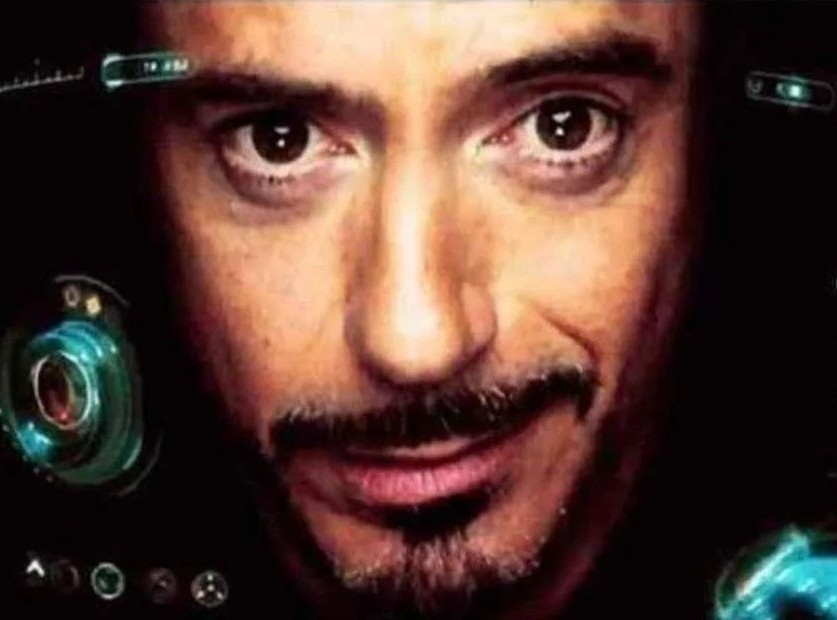

# Hi there 👋 I'm Selim

**Computer Engineering student at Süleyman Demirel University, Türkiye**

- 🤖 Working on machine learning, computer vision and ROS2
- 🚤 Building autonomous systems for Teknofest
- 🌱 Currently learning Spring Boot and full-stack development

 

## 🛠️ Tech Stack

  

## 📊 GitHub Stats

  
  

